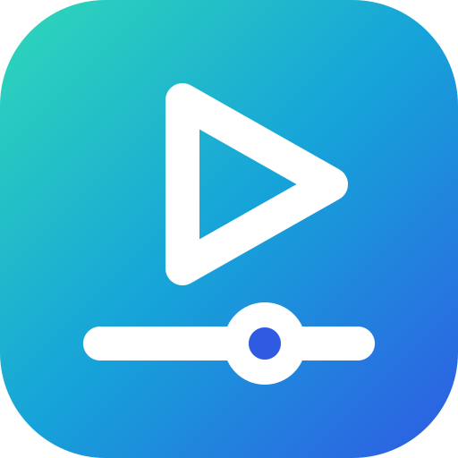

<div align="center">



# Mashhad · مشهد

**One fast, lightweight Windows app for photos *and* videos — with lossless cutting.**
**تطبيق ويندوز واحد، سريع وخفيف، للصور *والفيديو* — مع قصّ بلا فقد للجودة.**

[English](#english) · [العربية](#العربية)

</div>

---

## English

Mashhad combines the parts of **VLC**, **mpv** and **LosslessCut** that matter day to day, so one small app can
replace both the Windows Photos app and the default video player.

- **Engine:** embedded **libmpv** shows both videos and images; **FFmpeg** does editing/export.
  Hardware decoding (**D3D11VA**) is on by default. Native **WinUI 3** UI — no Electron, no browser.
- **Unified gallery:** open any file and browse *every image and video in the same folder* with the arrow keys
  (natural sort order). Neighbouring files are pre-read in the background so the next one opens without disk latency.
- **Video:** everything FFmpeg can decode, subtitles (embedded, external, drag & drop), audio/subtitle track
  selection, speed, frame stepping, A-B loop, screenshots, resume position, playlists (M3U), drag & drop.
- **Images:** JPG, PNG, WebP, GIF/APNG (animated), HEIC/AVIF/JXL where the bundled FFmpeg can decode them;
  zoom to cursor, pan, rotate, EXIF panel, crop.
- **Lossless editing:** in/out points on the timeline, multiple segments, cut and merge with stream copy
  (no re-encode), keyframe-aware cutting, frame export, remux to MKV/MP4/MOV.
- **Slideshow** mixing images (timed) and videos (played to the end).
- **Arabic and English**, right-to-left layout, dark/light themes, accent colours taken from the logo.

### Status

This is a first version. What has and has not been verified is listed honestly under
[Verification](#verification) and [Known gaps](#known-gaps).

### Keyboard and mouse

| Action | Keys |
| --- | --- |
| Play / pause | `Space`, `K`, right-click |
| Seek ±5 s / ±1 s exact / ±60 s | `←` `→` / `Shift`+`←` `→` / `Ctrl`+`←` `→` |
| Previous / next file in folder | `PageUp` `PageDown`, `P` `N`, mouse back/forward (images: also `←` `→`) |
| Frame step back / forward | `,` / `.` |
| Speed down / up / reset | `[` / `]` / `Backspace` |
| Volume / mute | `↑` `↓`, `9` `0`, mouse wheel / `M` |
| Audio track / subtitle track / subtitles on-off | `B` / `J` / `V` |
| Subtitle delay | `Z` / `X` |
| A-B loop (A, B, clear) / repeat file | `L` / `Shift`+`L` |
| Screenshot (with / without subtitles) | `S` / `Shift`+`S` |
| Full screen | `F`, `F11`, `Alt`+`Enter`, double-click; `Esc` leaves |
| Slideshow | `F5` |
| Images: zoom in / out / fit / 100 % | `+` / `-` / `0` / `1`, mouse wheel (zooms at the cursor), drag to pan |
| Images: rotate / crop | `R`, `Shift`+`R` / `C` (drag a rectangle, `Enter` saves a copy) |
| Lossless edit mode | `Ctrl`+`E` |
| Edit: in / out / new segment / split / remove | `I` / `O` / `+` / `B` / `Delete` |
| Edit: previous / next keyframe | `Alt`+`←` / `Alt`+`→` |
| Edit: export | `Ctrl`+`Enter` |
| Open file / folder, info, playlist, settings | `Ctrl`+`O` / `Ctrl`+`Shift`+`O`, `Ctrl`+`I`, `Ctrl`+`L`, `Ctrl`+`,` |

### How lossless cutting works

Export never re-encodes: FFmpeg copies the compressed packets (`-c copy`).

- A stream copy can only **start on a keyframe**. With *Snap to keyframes* on (default), each in point moves
  back to the previous keyframe, so the output starts cleanly and the file name shows the real times.
- The **out point** is exact for streams without B-frames; with B-frames it may run over by a frame or two
  (the reorder depth). This is inherent to stream copy.
- Several segments can be exported separately or **merged** into one file (FFmpeg concat demuxer).
- Output is written next to the source (or to the export folder in Settings) and never overwrites a file.
- Image rotate/crop writes a **new** file: PNG output is lossless; JPEG is re-encoded at high quality
  (true lossless JPEG transforms are not implemented).

### Build and run (Windows)

Requirements: Windows 10 1809+ or Windows 11 (x64), the [.NET 8 SDK](https://dotnet.microsoft.com/download/dotnet/8.0),
PowerShell. Visual Studio is optional. For the installer: [Inno Setup 6](https://jrsoftware.org/isinfo.php).

```powershell
git clone https://github.com/dem0ne/mashhad.git
cd mashhad

# 1. Download libmpv and FFmpeg into .\native (see below)
.\scripts\fetch-deps.ps1

# 2. Run from source
dotnet run --project src/Mashhad.App -p:Platform=x64

# 3. Or build a self-contained folder / portable zip / installer
.\scripts\build.ps1                      # publish\Mashhad\Mashhad.exe
.\scripts\build.ps1 -Zip -Installer      # dist\Mashhad-<ver>-win-x64.zip, dist\Mashhad-Setup-<ver>.exe
```

The build is **unpackaged and self-contained**: the output folder runs on a clean machine without installing
.NET or the Windows App SDK runtime. Every CI run also uploads the installer and zip as build artifacts.

Run the tests (works on Windows and Linux; FFmpeg/libmpv tests skip themselves if those are not installed):

```powershell
dotnet test tests/Mashhad.Tests
```

### Where libmpv and FFmpeg come from

They are **not** committed to this repository. `scripts/fetch-deps.ps1` downloads:

| Engine | Source | Files placed in |
| --- | --- | --- |
| libmpv | latest `mpv-dev-x86_64-*.7z` from [shinchiro/mpv-winbuild-cmake](https://github.com/shinchiro/mpv-winbuild-cmake/releases) | `native\mpv\libmpv-2.dll` |
| FFmpeg | latest release-branch `win64-lgpl-shared` build from [BtbN/FFmpeg-Builds](https://github.com/BtbN/FFmpeg-Builds/releases) | `native\ffmpeg\ffmpeg.exe`, `ffprobe.exe`, DLLs |

The app project copies those folders next to `Mashhad.exe` (`mpv\` and `ffmpeg\`). You can drop in your own builds
instead, pin exact versions with `-MpvUrl` / `-FfmpegUrl`, or point the app at another FFmpeg folder in Settings
(it also falls back to `PATH`). Extracting the mpv archive needs 7-Zip or a recent Windows `tar`.

**Licensing note:** the shinchiro libmpv builds are GPL; the BtbN build used here is LGPL. If you distribute
binaries that bundle them you must comply with those licences. This repository does not yet contain a licence
file for Mashhad's own code — that choice is the owner's.

### File associations and default app

The installer (per-user by default, no admin prompt) registers Mashhad for common image, video and audio
extensions through `OpenWithProgids` and `RegisteredApplications`. Windows 10/11 do not allow an app to make
itself the default silently, so the last step is yours: **Settings → Apps → Default apps → Mashhad** (the
installer and the in-app Settings panel both offer a shortcut to that page). Opening a second file reuses the
running window.

### Project layout

```
src/Mashhad.Core      media logic, no UI: gallery, queue, preloader, resume, shortcuts, image/crop math,
                      settings, localisation (en/ar), libmpv interop                       (net8.0)
src/Mashhad.Editing   FFmpeg wrapper: segments, keyframe index, command builder, planner, runner (net8.0)
src/Mashhad.App       WinUI 3 app (Windows App SDK 1.7): window, native video host, panels   (net8.0-windows)
tests/Mashhad.Tests   xUnit tests incl. real FFmpeg and headless libmpv integration tests
installer/            Inno Setup script (file associations)
scripts/              fetch-deps.ps1, build.ps1
assets/brand/         logo
```

How the video gets into a WinUI window: WinUI 3 has no native child-window control, so the app creates a plain
Win32 child window, hands its handle to libmpv (`--wid`) and keeps it positioned over a placeholder element.
mpv renders with its own D3D11 pipeline (zero-copy D3D11VA), which is the lowest-overhead path. The trade-off is
that XAML cannot draw *on top of* the video, so controls sit around it and menus use separate popup windows.

### Verification

Verified in automated tests (run on Linux, and again on Windows in CI):

- Gallery scanning/sorting, queue navigation, shuffle, playlists, preloader, resume store, slideshow policy,
  shortcut map, settings, zoom/pan/crop math, localisation (key parity, every key used by the UI exists).
- **Lossless cut/merge/remux against real FFmpeg**: outputs are decoded and compared frame-by-frame with the
  source for MP4, MKV, MOV and MPEG-TS, with and without B-frames; also frame export, image rotate/crop,
  failure clean-up and cancellation.
- **libmpv interop against a real libmpv** (headless): load, properties and events, exact seek, frame step,
  speed, A-B loop, resume start position, still images with zoom/pan/rotate, error paths, and every mpv
  command/property the app uses.

See the pull request / CI run for the state of the Windows build and the app smoke test
(`Mashhad.exe --smoke-test`, which opens the window, exercises the panels, language switch and edit mode, and
plays a real video and image).

### Known gaps

- The UI has been exercised only by the automated smoke test, **not by a person on a real desktop**: expect
  visual rough edges. GPU hardware decoding cannot be exercised on CI machines (no GPU).
- Controls cannot overlay the video (see above); in full screen the bar appears when the pointer nears the
  bottom edge and the video area resizes slightly while it is shown.
- "Preload" warms the OS file cache for the neighbouring files; it does not pre-decode them.
- Lossless JPEG rotation/crop, video crop, per-stream selection on export, chapters editing, a thumbnail strip,
  waveform, and segment labels in the UI are not implemented.
- HEIC/AVIF depend on the decoders in the bundled libmpv build.
- x64 only; no MSIX/Store package; no code signing (SmartScreen will warn on the installer).

---

## العربية

<div dir="rtl">

«مشهد» يجمع أهم ما في **VLC** و**mpv** و**LosslessCut** في تطبيق صغير واحد، ليغني عن تطبيق «الصور» ومشغّل الفيديو
الافتراضي في ويندوز معًا.

- **المحرك:** مكتبة **libmpv** مضمَّنة لعرض الفيديو والصور، و**FFmpeg** للتحرير والتصدير. فكّ الترميز بالعتاد
  (**D3D11VA**) مفعّل افتراضيًا. واجهة **WinUI 3** أصلية — بلا Electron ولا متصفح.
- **معرض موحَّد:** افتح أي ملف وتصفّح *كل الصور والفيديوهات في المجلد نفسه* بمفاتيح الأسهم. تُقرأ الملفات المجاورة
  مسبقًا في الخلفية ليُفتح التالي دون انتظار القرص.
- **الفيديو:** كل الصيغ التي يدعمها FFmpeg، الترجمات (المضمّنة والخارجية وبالسحب والإفلات)، اختيار مسار الصوت
  والترجمة، السرعة، التنقل إطارًا بإطار، تكرار A-B، لقطات الشاشة، متابعة التشغيل من موضع التوقف، قوائم التشغيل.
- **الصور:** JPG و PNG و WebP و GIF المتحركة، و HEIC/AVIF حيث أمكن؛ تكبير عند المؤشر، تحريك، تدوير، لوحة EXIF، قص.
- **تحرير بلا فقد:** نقاط بداية ونهاية على الخط الزمني، مقاطع متعددة، قص ودمج بنسخ المسارات (دون إعادة ترميز)،
  قص يراعي الإطارات المفتاحية، تصدير الإطارات، تحويل الحاوية إلى MKV/MP4/MOV.
- **عرض شرائح** يمزج الصور (بمدة محددة) والفيديو (حتى نهايته).
- **العربية والإنجليزية**، اتجاه من اليمين إلى اليسار، مظهر داكن وفاتح، وألوان مشتقة من الشعار.

### الحالة

هذه نسخة أولى. ما تم التحقق منه وما لم يتم مذكور بصراحة في قسمَي «التحقق» و«النواقص المعروفة».

### أهم الاختصارات

| الإجراء | المفاتيح |
| --- | --- |
| تشغيل / إيقاف مؤقت | `Space`، `K`، النقر بالزر الأيمن |
| تقديم/ترجيع ٥ ث / ١ ث بدقة / ٦٠ ث | `←` `→` / `Shift`+`←` `→` / `Ctrl`+`←` `→` |
| الملف السابق / التالي في المجلد | `PageUp` `PageDown`، `P` `N` (وفي الصور: `←` `→`) |
| إطار للخلف / للأمام | `,` / `.` |
| السرعة: أبطأ / أسرع / إعادة | `[` / `]` / `Backspace` |
| الصوت / كتم | `↑` `↓`، عجلة الفأرة / `M` |
| مسار الصوت / الترجمة / إظهار الترجمة | `B` / `J` / `V` |
| تكرار A-B | `L` |
| لقطة شاشة | `S` |
| ملء الشاشة | `F`، `F11`، نقر مزدوج؛ `Esc` للخروج |
| عرض الشرائح | `F5` |
| الصور: تكبير / تصغير / ملاءمة / ‎100% | `+` / `-` / `0` / `1`، عجلة الفأرة، السحب للتحريك |
| الصور: تدوير / قص | `R` / `C` |
| وضع التحرير بلا فقد | `Ctrl`+`E` |
| التحرير: بداية / نهاية / مقطع جديد / تقسيم / حذف | `I` / `O` / `+` / `B` / `Delete` |
| التحرير: الإطار المفتاحي السابق / التالي | `Alt`+`←` / `Alt`+`→` |
| التحرير: تصدير | `Ctrl`+`Enter` |

### كيف يعمل القص بلا فقد

التصدير لا يعيد الترميز أبدًا: ينسخ FFmpeg الحزم المضغوطة كما هي (`-c copy`).

- النسخ لا يبدأ إلا من **إطار مفتاحي**. مع خيار «المحاذاة للإطارات المفتاحية» (الافتراضي) تُرجَع كل نقطة بداية إلى
  الإطار المفتاحي السابق، فيبدأ الناتج نظيفًا ويُظهر اسم الملف الأزمنة الفعلية.
- **نقطة النهاية** دقيقة في المسارات الخالية من إطارات B، وقد تزيد إطارًا أو اثنين عند وجودها. هذا من طبيعة النسخ.
- يمكن تصدير المقاطع منفصلة أو **دمجها** في ملف واحد.
- يُكتب الناتج بجانب الملف الأصلي (أو في مجلد التصدير المحدد في الإعدادات) ولا يُستبدل أي ملف موجود.
- تدوير/قص الصور يكتب ملفًا **جديدًا**: ‏PNG بلا فقد، و JPEG يُعاد ترميزه بجودة عالية.

### البناء والتشغيل (ويندوز)

المتطلبات: ويندوز 10 (1809 فما فوق) أو ويندوز 11 (x64)، و[‎.NET 8 SDK](https://dotnet.microsoft.com/download/dotnet/8.0)،
و PowerShell. ‏Visual Studio اختياري. ولبناء المثبِّت: [Inno Setup 6](https://jrsoftware.org/isinfo.php).

</div>

```powershell
git clone https://github.com/dem0ne/mashhad.git
cd mashhad

# 1. تنزيل libmpv و FFmpeg إلى المجلد native
.\scripts\fetch-deps.ps1

# 2. التشغيل من المصدر
dotnet run --project src/Mashhad.App -p:Platform=x64

# 3. أو بناء مجلد مستقل / ملف مضغوط محمول / مثبِّت
.\scripts\build.ps1
.\scripts\build.ps1 -Zip -Installer
```

<div dir="rtl">

الناتج **مستقل بذاته**: يعمل على جهاز نظيف دون تثبيت ‎.NET أو Windows App SDK. كما يرفع كل تشغيل للـ CI المثبِّتَ
والملف المضغوط كمخرجات بناء.

تشغيل الاختبارات (على ويندوز أو لينكس؛ اختبارات FFmpeg و libmpv تتخطى نفسها إن لم يكونا مثبتين):

</div>

```powershell
dotnet test tests/Mashhad.Tests
```

<div dir="rtl">

### من أين تأتي ملفات libmpv و FFmpeg

هذه الملفات **غير مضمّنة** في المستودع. السكربت `scripts/fetch-deps.ps1` ينزّل:

| المحرك | المصدر | مكان الملفات |
| --- | --- | --- |
| libmpv | أحدث `mpv-dev-x86_64-*.7z` من [shinchiro/mpv-winbuild-cmake](https://github.com/shinchiro/mpv-winbuild-cmake/releases) | `native\mpv\libmpv-2.dll` |
| FFmpeg | أحدث بناء `win64-lgpl-shared` من [BtbN/FFmpeg-Builds](https://github.com/BtbN/FFmpeg-Builds/releases) | `native\ffmpeg\` |

ينسخ مشروع التطبيق هذين المجلدين بجانب `Mashhad.exe`. يمكنك وضع نسخك الخاصة بدلًا منها، أو تثبيت إصدارات محددة
بالخيارين `-MpvUrl` و `-FfmpegUrl`، أو تحديد مجلد FFmpeg آخر من الإعدادات. فكّ أرشيف mpv يحتاج 7-Zip أو `tar`
حديثًا في ويندوز.

**ملاحظة ترخيص:** بناءات libmpv من shinchiro مرخّصة بـ GPL، وبناء FFmpeg المستخدم هنا بـ LGPL؛ توزيعها مع التطبيق
يستلزم الالتزام بهذه التراخيص. ولم يُضَف بعدُ ملف ترخيص لشيفرة «مشهد» نفسها — القرار لمالك المستودع.

### ربط أنواع الملفات والتطبيق الافتراضي

يسجّل المثبِّت (للمستخدم الحالي افتراضيًا، دون صلاحيات مدير) «مشهد» لأشهر امتدادات الصور والفيديو والصوت. ويندوز
10/11 لا يسمح لأي تطبيق بأن يجعل نفسه افتراضيًا تلقائيًا، فالخطوة الأخيرة عندك:
**الإعدادات ← التطبيقات ← التطبيقات الافتراضية ← Mashhad**. فتح ملف ثانٍ يستخدم النافذة المفتوحة نفسها.

### التحقق

تم التحقق باختبارات آلية (على لينكس، ثم على ويندوز في CI):

- منطق المعرض والترتيب والتنقل وقوائم التشغيل والتحميل المسبق ومتابعة التشغيل وعرض الشرائح والاختصارات والإعدادات
  وحسابات التكبير والقص، والترجمة (تطابق المفاتيح بين اللغتين ووجود كل مفتاح تستخدمه الواجهة).
- **القص والدمج وتحويل الحاوية بلا فقد على FFmpeg حقيقي**: تُفكّ ترميز النواتج وتُقارن إطارًا بإطار مع الأصل لصيغ
  MP4 و MKV و MOV و MPEG-TS، مع إطارات B وبدونها.
- **الربط مع libmpv حقيقي** (دون شاشة): التحميل، الخصائص والأحداث، التنقل الدقيق، إطار بإطار، السرعة، تكرار A-B،
  موضع المتابعة، الصور الثابتة مع التكبير والتدوير، ومسارات الخطأ.

راجع طلب الدمج / تشغيل الـ CI لمعرفة حالة بناء ويندوز واختبار التشغيل الآلي للتطبيق.

### النواقص المعروفة

- الواجهة جُرّبت بالاختبار الآلي فقط، **ولم يجرّبها إنسان على سطح مكتب حقيقي**: توقّع بعض العيوب الشكلية. ولا يمكن
  اختبار فك الترميز بالعتاد على أجهزة CI (بلا بطاقة رسوميات).
- لا يمكن رسم عناصر التحكم فوق الفيديو؛ في وضع ملء الشاشة يظهر الشريط عند اقتراب المؤشر من الحافة السفلية.
- «التحميل المسبق» يُدفئ ذاكرة الملفات المؤقتة للملفات المجاورة ولا يفك ترميزها مسبقًا.
- غير منفَّذ بعد: تدوير/قص JPEG بلا فقد، قص الفيديو، اختيار المسارات عند التصدير، شريط مصغّرات، تسمية المقاطع.
- ‏x64 فقط؛ لا حزمة MSIX؛ المثبِّت غير موقَّع رقميًا.

</div>
